# 내 컴퓨터에 개발용 '작업실' 꾸미기

> 코디세이 AI 올인원 1기 입학 연수 미션 — Windows(WSL2) 개발 워크스테이션 구축 기록

## 1. 프로젝트 개요

터미널, Docker, Git을 직접 세팅해 "내 컴퓨터에서만 되는" 문제 없이 누구나 같은 방식으로 실행할 수 있는 개발 환경을 구성했다.

- 터미널로 작업 폴더 구성, 파일 조작, 권한 변경
- Docker 설치 점검, 컨테이너 실행/운영
- Dockerfile로 nginx 기반 커스텀 웹 서버 이미지 제작, 포트 매핑 접속
- 바인드 마운트(변경 반영)와 볼륨(데이터 영속성) 검증
- Git 설정, GitHub 저장소 push, VSCode GitHub 연동

## 2. 실행 환경

| 항목 | 값 |
| --- | --- |
| Host OS | Windows |
| Linux 환경 | WSL2 Ubuntu 26.04.1 LTS |
| Shell / 터미널 | bash (`/bin/bash`) / Windows Terminal |
| Docker | Docker Desktop, Docker version 29.9.2 (WSL Integration 사용) |
| Git | git version 2.53.0 |
| 에디터 | VSCode + WSL 확장 |

```bash
$ cat /etc/os-release | head -2
PRETTY_NAME="Ubuntu 26.04.1 LTS"
NAME="Ubuntu"
$ echo $SHELL
/bin/bash
$ docker --version
Docker version 29.9.2, build a82e528
$ git --version
git version 2.53.0
```

## 3. 수행 체크리스트

- [x] 터미널 기본 조작 및 폴더 구성
- [x] 권한 변경 실습 (파일 1, 디렉토리 1)
- [x] Docker 설치/점검 (version, info)
- [x] hello-world 실행 / ubuntu 컨테이너 진입
- [x] Docker 운영 명령 (images, ps -a, logs, stats)
- [x] attach / exec 차이 관찰
- [x] Dockerfile 커스텀 이미지 빌드/실행
- [x] 포트 매핑 접속 (8080, 8081 2회)
- [x] 바인드 마운트 반영
- [x] 볼륨 영속성
- [x] 포트 충돌 진단과 해결
- [x] Git 설정 + GitHub push + VSCode GitHub 연동

## 4. 저장소 구조

```
.
├── README.md
├── Dockerfile
├── app/
│   └── index.html      # nginx로 서비스할 정적 페이지
├── images/             # 증거 스크린샷
└── practice/           # 터미널·권한 실습 파일
```

구성 기준:
- 저장소 루트에 `Dockerfile`을 두어 `docker build .` 한 줄로 빌드되게 했다. 빌드에 들어가는 파일은 `app/`으로 한정해, 실습용 파일(`practice/`)이나 스크린샷(`images/`)이 이미지에 섞이지 않게 했다.
- 증거는 `images/`에 단계 번호 순(`01-` ~ `10-`, 트러블슈팅은 `ts1-` ~ `ts3-`)으로 이름을 붙여, README의 섹션 번호와 바로 대응되게 했다.

## 5. 수행 로그

### 5-1. 터미널 기본 조작

```bash
$ mkdir -p ~/codyssey/workstation
$ cd ~/codyssey/workstation
$ pwd
/home/hyejin/codyssey/workstation
$ ls -la
total 8
drwxr-xr-x 2 hyejin hyejin 4096 Nov  4 13:04 .
drwxr-xr-x 3 hyejin hyejin 4096 Nov  4 13:04 ..

$ mkdir practice && cd practice
$ touch empty.txt
$ echo "hello codyssey" > note.txt
$ cat note.txt
hello codyssey
$ touch .hidden
$ ls
empty.txt  note.txt
$ ls -la
total 12
drwxr-xr-x 2 hyejin hyejin 4096 Nov  4 13:05 .
drwxr-xr-x 3 hyejin hyejin 4096 Nov  4 13:04 ..
-rw-r--r-- 1 hyejin hyejin    0 Nov  4 13:05 .hidden
-rw-r--r-- 1 hyejin hyejin    0 Nov  4 13:04 empty.txt
-rw-r--r-- 1 hyejin hyejin   15 Nov  4 13:04 note.txt
```

- `ls`에는 보이지 않던 `.hidden`, `.`, `..`가 `ls -la`에서 보인다 (숨김 파일 확인).
- `empty.txt`는 0바이트(빈 파일), `note.txt`는 15바이트("hello codyssey" 14자 + 줄바꿈).

```bash
$ cp note.txt note_copy.txt              # 복사
$ mv note_copy.txt renamed.txt           # 이름 변경
$ ls -la
...
-rw-r--r-- 1 hyejin hyejin   15 Nov  4 13:05 renamed.txt
$ mv renamed.txt backup/                 # 이동 (backup은 mkdir로 생성)
$ ls -la backup
total 12
drwxr-xr-x 2 hyejin hyejin 4096 Nov  4 13:13 .
drwxr-xr-x 3 hyejin hyejin 4096 Nov  4 13:13 ..
-rw-r--r-- 1 hyejin hyejin   15 Nov  4 13:05 renamed.txt
$ rm backup/renamed.txt                  # 파일 삭제
$ rmdir backup                           # 빈 디렉토리 삭제
$ ls -la
total 12
drwxr-xr-x 2 hyejin hyejin 4096 Nov  4 13:14 .
drwxr-xr-x 3 hyejin hyejin 4096 Nov  4 13:04 ..
-rw-r--r-- 1 hyejin hyejin    0 Nov  4 13:05 .hidden
-rw-r--r-- 1 hyejin hyejin    0 Nov  4 13:04 empty.txt
-rw-r--r-- 1 hyejin hyejin   15 Nov  4 13:04 note.txt
$ cd ..
$ pwd
/home/hyejin/codyssey/workstation
```


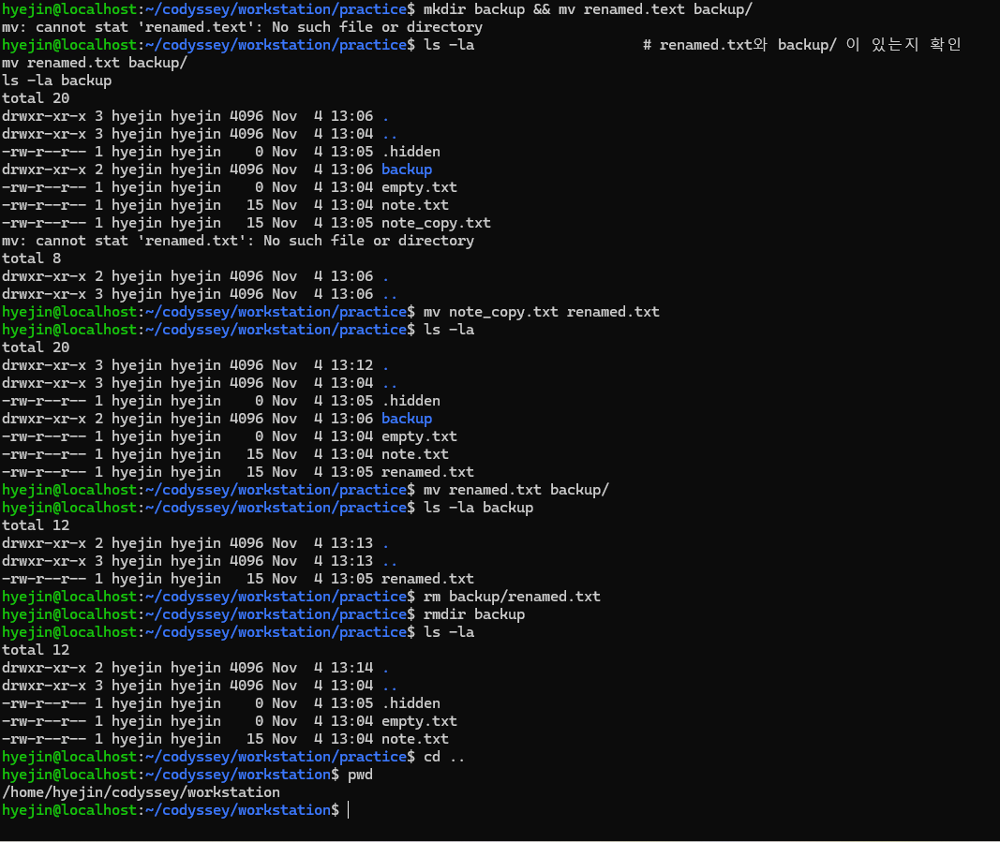

### 5-2. 권한 실습

```bash
$ ls -l note.txt
-rw-r--r-- 1 hyejin hyejin 15 Nov  4 13:04 note.txt     # 변경 전 644
$ chmod 755 note.txt
$ ls -l note.txt
-rwxr-xr-x 1 hyejin hyejin 15 Nov  4 13:04 note.txt     # 변경 후 755
$ chmod 644 note.txt
$ ls -l note.txt
-rw-r--r-- 1 hyejin hyejin 15 Nov  4 13:04 note.txt     # 원복

$ mkdir secret_dir
$ ls -ld secret_dir
drwxr-xr-x 2 hyejin hyejin 4096 Nov  4 13:19 secret_dir # 변경 전 755
$ chmod 700 secret_dir
$ ls -ld secret_dir
drwx------ 2 hyejin hyejin 4096 Nov  4 13:19 secret_dir # 변경 후 700

$ stat -c '%A %a %n' note.txt secret_dir
-rw-r--r-- 644 note.txt
drwx------ 700 secret_dir
```

| 대상 | 변경 전 | 변경 후 |
| --- | --- | --- |
| note.txt (파일) | `-rw-r--r--` 644 | `-rwxr-xr-x` 755 → 644 원복 |
| secret_dir (디렉토리) | `drwxr-xr-x` 755 | `drwx------` 700 |

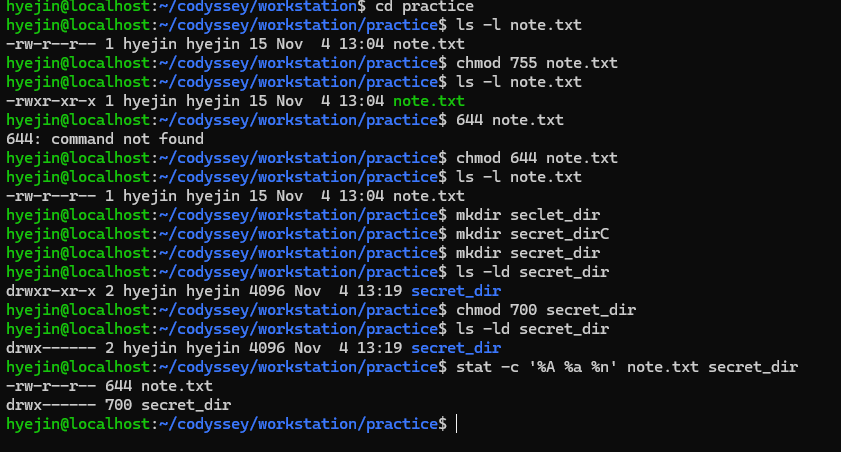 

각 변경의 이유:
- `note.txt` → 755: 일반 파일에 실행 권한(x)을 붙이면 어떻게 표시되는지(`-rwxr-xr-x`, 초록색 이름) 확인하려는 실험이다.
- `note.txt` → 644 원복: 텍스트 문서는 실행할 필요가 없으므로, 필요한 권한만 주는 최소 권한 원칙에 따라 되돌렸다.
- `secret_dir` → 700: 그룹과 기타 사용자의 읽기·진입을 모두 막고 소유자만 쓰게 했다. 개인 설정이나 키처럼 다른 사용자가 보면 안 되는 파일을 두는 폴더에 쓰는 설정이다.

### 5-3. Docker 설치 점검

```bash
$ docker --version
Docker version 29.9.2, build a82e528
$ docker info | grep -A 8 "Server:"
Server:
 Containers: 1
  Running: 0
  Paused: 0
  Stopped: 1
 Images: 1
 Server Version: 29.9.2
 Storage Driver: overlayfs
  driver-type: io.containerd.snapshotter.v1
```

`Server:` 정보가 출력되므로 Docker 데몬이 정상 동작한다.

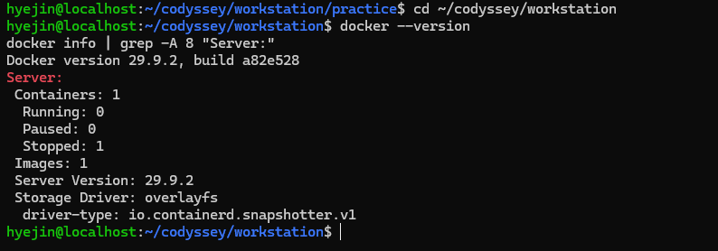

### 5-4. 컨테이너 실행 실습

```bash
$ docker run hello-world
...
Hello from Docker!
This message shows that your installation appears to be working correctly.
...

$ docker run -it --name my-ubuntu ubuntu bash
root@2110c6fe125f:/# echo "inside container"
inside container
root@2110c6fe125f:/# cat /etc/os-release | head -2
PRETTY_NAME="Ubuntu 26.04.1 LTS"
NAME="Ubuntu"
root@2110c6fe125f:/# ls /
bin  boot  dev  etc  home  lib  lib64  media  mnt  opt  proc  root  run  sbin  srv  sys  tmp  usr  var
root@2110c6fe125f:/# exit
```

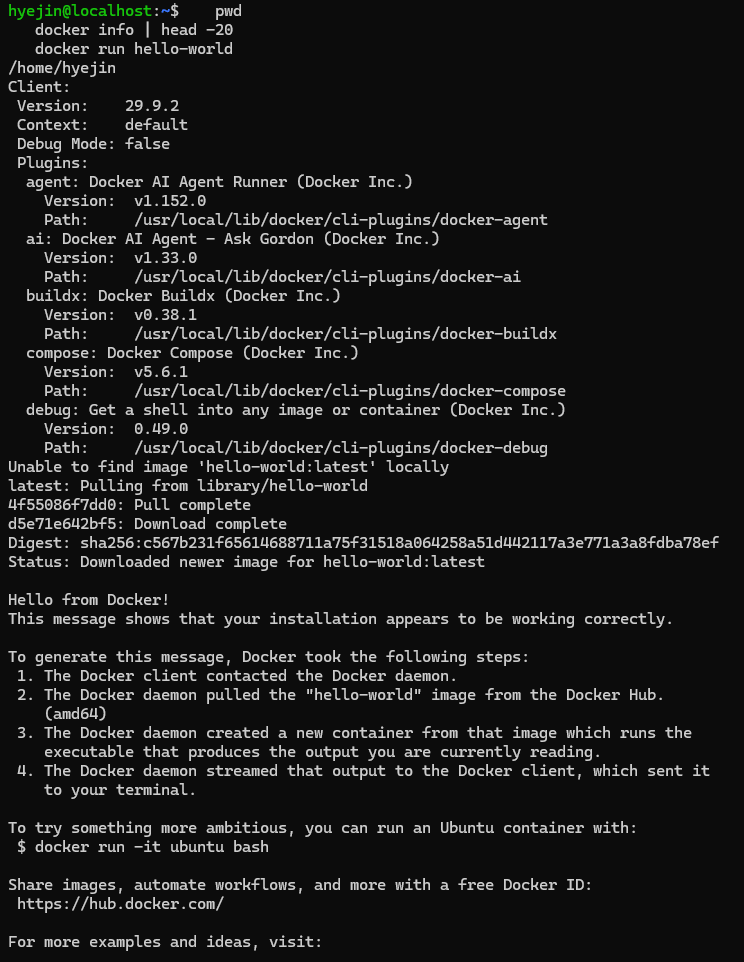

프롬프트가 `root@2110c6fe125f`(컨테이너 ID)로 바뀌고, 호스트의 `/home/hyejin` 파일이 보이지 않는 격리된 환경임을 확인했다.

**attach vs exec 관찰 결과**

```bash
$ docker start my-ubuntu
$ docker exec -it my-ubuntu bash
root@2110c6fe125f:/# exit
$ docker ps
CONTAINER ID   IMAGE    COMMAND   CREATED          STATUS          PORTS   NAMES
2110c6fe125f   ubuntu   "bash"    33 minutes ago   Up 23 minutes           my-ubuntu   # exec 후: 유지

$ docker attach my-ubuntu
root@2110c6fe125f:/# exit
$ docker ps -a
CONTAINER ID   IMAGE         COMMAND    CREATED             STATUS                       NAMES
2110c6fe125f   ubuntu        "bash"     36 minutes ago      Exited (0) 54 seconds ago    my-ubuntu   # attach 후: 종료
8f2a797e14f3   hello-world   "/hello"   About an hour ago   Exited (0) About an hour ago vibrant_elgamal
```

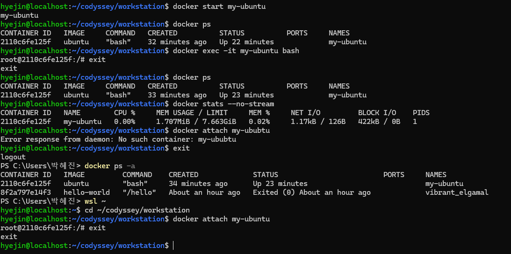
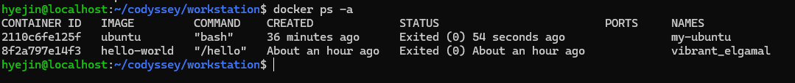

- `docker exec`는 컨테이너 안에 bash를 **하나 더** 실행한다. 그 bash에서 exit해도 메인 프로세스는 그대로라 컨테이너가 Up 상태로 유지된다.
- `docker attach`는 컨테이너의 **메인 프로세스(PID 1)**에 연결된다. 거기서 exit하면 메인 프로세스가 끝나므로 컨테이너도 Exited가 된다.

### 5-5. Docker 운영 명령

```bash
$ docker images
IMAGE                ID             DISK USAGE   CONTENT SIZE
hello-world:latest   c567b231f656   25.9kB       9.49kB
ubuntu:latest        6a06111c3b0a   163MB        45.9MB

$ docker ps
CONTAINER ID   IMAGE   COMMAND   CREATED   STATUS   PORTS   NAMES     # 실행 중인 컨테이너 없음

$ docker ps -a
CONTAINER ID   IMAGE         COMMAND    CREATED          STATUS                     NAMES
2110c6fe125f   ubuntu        "bash"     8 minutes ago    Exited (0) 12 seconds ago  my-ubuntu
8f2a797e14f3   hello-world   "/hello"   48 minutes ago   Exited (0) 48 minutes ago  vibrant_elgamal

$ docker logs my-ubuntu
root@2110c6fe125f:/# ls .
bin  boot  dev  etc ...
root@2110c6fe125f:/# echo "inside container"
inside container
...

$ docker stats --no-stream
CONTAINER ID   NAME        CPU %   MEM USAGE / LIMIT     MEM %   NET I/O         BLOCK I/O     PIDS
2110c6fe125f   my-ubuntu   0.00%   1.707MiB / 7.663GiB   0.02%   1.17kB / 126B   422kB / 0B    1
```

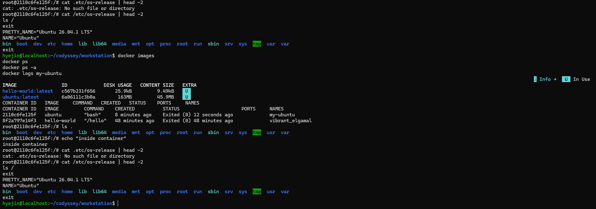

- `--name` 없이 실행한 hello-world 컨테이너는 Docker가 `vibrant_elgamal`이라는 이름을 자동으로 붙였다.
- `docker logs`에는 컨테이너 안에서 입력한 명령과 출력이 그대로 기록된다.

실습에서 쓴 이미지·컨테이너 ID와 이름 (각 단계 출력에서 정리):

| 구분 | ID (앞 12자리) | 이름 | 용도 |
| --- | --- | --- | --- |
| 이미지 | `c567b231f656` | hello-world:latest | 설치 확인 |
| 이미지 | `6a06111c3b0a` | ubuntu:latest | 컨테이너 진입, 볼륨 실습 |
| 이미지 | `88a2d5f010f0` | my-web:1.0 | Dockerfile로 만든 커스텀 웹 서버 |
| 컨테이너 | `8f2a797e14f3` | vibrant_elgamal | hello-world 실행 (이름 자동 생성) |
| 컨테이너 | `2110c6fe125f` | my-ubuntu | ubuntu 진입, attach/exec 비교 |
| 컨테이너 | `67c68230cb46` | my-web-8080 | 포트 매핑 8080:80 |
| 컨테이너 | `d90747f965dd` | my-web-8081 | 포트 매핑 8081:80 |
| 컨테이너 | `27aa34fa0a0f` | vol-test2 | 볼륨 영속성 확인 |

### 5-6. Dockerfile 커스텀 이미지

- 선택한 방식: **(A) 웹 서버 베이스 이미지 활용** — `nginx:alpine` + 정적 콘텐츠 교체
- 베이스 선택 이유: nginx는 별도 설정 없이 정적 파일을 바로 서비스하고, alpine 버전은 용량이 작아 빌드와 실행이 빠르다.

```dockerfile
FROM nginx:alpine
LABEL org.opencontainers.image.title="Hyejin's web"
ENV APP_ENV=dev
COPY app/ /usr/share/nginx/html
HEALTHCHECK CMD wget -q -O /dev/null http://localhost/ || exit 1
EXPOSE 80
```

| 커스텀 포인트 | 목적 |
| --- | --- |
| `LABEL` | 이미지에 제목 메타데이터를 붙여 식별하기 쉽게 함 |
| `ENV APP_ENV=dev` | 실행 모드를 환경 변수로 주입 (설정과 코드 분리) |
| `COPY app/ ...` | nginx 기본 페이지를 내가 만든 페이지로 교체 |
| `HEALTHCHECK` | 30초마다 웹 서버 응답을 점검해 `docker ps`에 healthy/unhealthy 표시 |
| `EXPOSE 80` | 컨테이너가 사용하는 포트를 문서화 |

```bash
$ docker build -t my-web:1.0 .
[+] Building 4.9s (7/7) FINISHED
 => [1/2] FROM docker.io/library/nginx:alpine@sha256:785835ea...
 => [2/2] COPY app/ /usr/share/nginx/html
 => exporting to image
 => => naming to docker.io/library/my-web:1.0
$ docker images | grep my-web
my-web:1.0   88a2d5f010f0   93.6MB   26.3MB
```

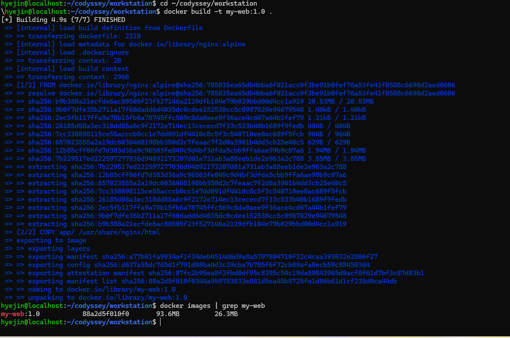

주요 지시어의 동작:
- `HEALTHCHECK`: 옵션을 생략했으므로 기본값(30초 간격, 30초 타임아웃, 3회 연속 실패 시 unhealthy)으로 동작한다. 컨테이너 안에서 `wget`으로 `http://localhost/`에 접속해 성공하면 healthy가 된다. 실제로 `docker ps`가 `health: starting`에서 `healthy`로 바뀌었고, nginx 로그에 30초마다 `"Wget"` 요청이 찍힌 것으로 확인했다 (5-7 참고).
- `EXPOSE 80`: "이 컨테이너는 80번을 쓴다"는 문서 역할만 하고, 포트를 실제로 열지는 않는다. 호스트에서 접속하려면 실행할 때 `-p 8080:80`으로 매핑해야 한다.
- `ENV APP_ENV=dev`: 컨테이너 안의 환경 변수로 들어간다. `docker exec <컨테이너> env | grep APP_ENV`로 확인할 수 있다.

### 5-7. 포트 매핑 접속

```bash
$ docker run -d -p 8080:80 --name my-web-8080 my-web:1.0
$ docker run -d -p 8081:80 --name my-web-8081 my-web:1.0
$ docker ps
CONTAINER ID   IMAGE        STATUS                    PORTS                                     NAMES
d90747f965dd   my-web:1.0   Up 2 minutes (healthy)    0.0.0.0:8081->80/tcp, [::]:8081->80/tcp   my-web-8081
67c68230cb46   my-web:1.0   Up 2 minutes (healthy)    0.0.0.0:8080->80/tcp, [::]:8080->80/tcp   my-web-8080

$ curl http://localhost:8080
<!DOCTYPE html>
<html>
    <head><meta charset="utf-8"><title>Hyejin's Workstation</title></head>
<body>
    <h1>Hyejin's Dev Workstation v1</h1>
    <p>Cody 미션 진행-Docker로 웹 서버 만들기</p>
</body>
</html>
$ curl http://localhost:8081
(위와 동일)

$ docker logs my-web-8080
...
::1 - - [04/Nov/2026:05:54:13 +0000] "GET / HTTP/1.1" 200 226 "-" "Wget" "-"
172.17.0.1 - - [04/Nov/2026:05:55:05 +0000] "GET / HTTP/1.1" 200 226 "-" "curl/8.18.0" "-"
...
```

- 같은 이미지로 호스트 포트만 다르게(8080, 8081) 두 컨테이너를 동시에 실행했다.
- 로그의 `"Wget"`(30초 간격)은 HEALTHCHECK, `172.17.0.1 ... curl`은 호스트에서 포트 매핑을 거쳐 들어온 요청이다.

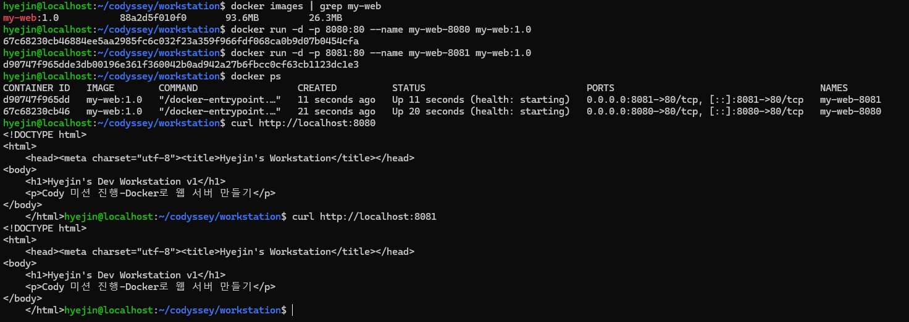
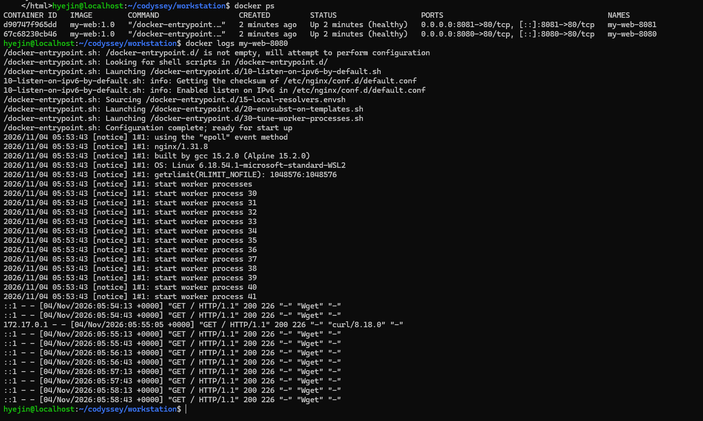


접속 범위와 주의사항:
- `docker ps`의 `0.0.0.0:8080->80/tcp`는 호스트의 모든 네트워크 주소에서 8080을 받는다는 뜻이다. Windows + Docker Desktop에서는 Windows의 `localhost:8080`으로 바로 접속된다.
- 같은 네트워크의 다른 PC에서 접속하려면 `http://<내 PC의 IP>:8080`을 쓰고, Windows 방화벽에서 해당 포트의 인바운드 허용이 필요할 수 있다. 회사·학교 네트워크는 정책상 막혀 있을 수 있다.
- 내 PC에서만 접속되게 하려면 `-p 127.0.0.1:8080:80`처럼 주소를 지정해 실행한다.

### 5-7-1. 포트 충돌 진단과 해결

일부러 이미 쓰고 있는 8080으로 컨테이너를 하나 더 실행해 충돌을 만들고, 원인을 찾아 해결했다.

**1) 충돌 재현**

```bash
$ docker start my-web-8080
$ docker ps
CONTAINER ID   IMAGE        STATUS                            PORTS                                     NAMES
67c68230cb46   my-web:1.0   Up 5 seconds (health: starting)   0.0.0.0:8080->80/tcp, [::]:8080->80/tcp   my-web-8080

$ docker run -d -p 8080:80 --name port-conflict my-web:1.0
3ef6fdd6a199a23196750c1f148f6850fcd99ffb21e2f6f060dc666a9d6b4567
docker: Error response from daemon: failed to set up container networking: driver failed programming
external connectivity on endpoint port-conflict (...): Bind for 0.0.0.0:8080 failed: port is already allocated
```

**2) 원인 진단: 누가 8080을 쓰고 있나**

```bash
$ docker ps --filter "publish=8080"          # 8080을 게시한 컨테이너 찾기
CONTAINER ID   IMAGE        STATUS                    PORTS                                     NAMES
67c68230cb46   my-web:1.0   Up 2 minutes (healthy)    0.0.0.0:8080->80/tcp, [::]:8080->80/tcp   my-web-8080

$ docker port my-web-8080                     # 그 컨테이너의 포트 매핑 확인
80/tcp -> 0.0.0.0:8080
80/tcp -> [::]:8080

$ docker ps -a --filter "name=port-conflict"  # 실패한 컨테이너 상태 확인
CONTAINER ID   IMAGE        CREATED         STATUS    PORTS     NAMES
3ef6fdd6a199   my-web:1.0   2 minutes ago   Created             port-conflict
```

- 원인: `my-web-8080`이 호스트 8080을 이미 점유하고 있었다.
- 실행은 실패했지만 컨테이너는 `Created` 상태로 남는다. 이 상태로 두면 같은 이름으로 다시 실행할 때 이름 충돌 오류가 나므로 먼저 지운다.

**3) 해결: 포트를 비우고 다시 실행**

```bash
$ docker rm port-conflict                     # 실패한 컨테이너 정리
port-conflict
$ docker stop my-web-8080                     # 포트를 점유한 컨테이너 중지
my-web-8080
$ docker run -d -p 8080:80 --name port-conflict my-web:1.0
dcf266af4cca1ba07c5744aee5acadf1bd5ed951fade1be41a893aa4bbb9f816   # 이번엔 성공
$ docker rm -f port-conflict                  # 실습 정리
$ docker start my-web-8080                    # 원래 상태로 복구
```

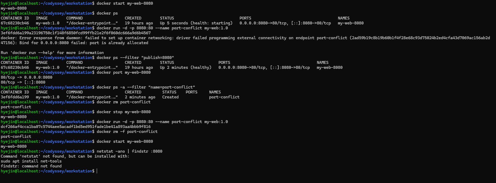

해결 방법 정리:

| 상황 | 방법 |
| --- | --- |
| 기존 컨테이너를 계속 써야 함 | 다른 호스트 포트로 실행 (`-p 8083:80`) |
| 기존 컨테이너가 필요 없음 | `docker stop` 또는 `docker rm -f`로 포트를 비운 뒤 실행 |
| Docker가 아닌 프로그램이 포트를 점유 | Windows PowerShell에서 `netstat -ano \| findstr :8080`으로 PID를 찾고 `tasklist /FI "PID eq <PID>"`로 프로그램 확인 후 종료. Linux에서는 `ss -ltnp \| grep 8080` |

주의: `netstat ... | findstr`을 Ubuntu 터미널에서 실행하자 `netstat not found`, `findstr: command not found`가 났다. `findstr`는 Windows 전용 명령이라 PowerShell에서 실행해야 하고, Ubuntu에서는 `ss` 같은 Linux 명령을 쓴다.

### 5-8. 바인드 마운트

```bash
$ docker run -d -p 8082:80 --name my-web-bind -v "$(pwd)/app":/usr/share/nginx/html my-web:1.0
$ curl http://localhost:8082
...
    <h1>Hyejin's Dev Workstation v1</h1>      # 변경 전
...
$ echo "<hi>changed on host (bind mount)</h1>" > app/index.html   # 호스트에서 수정
$ curl http://localhost:8082
<hi>changed on host (bind mount)</h1>         # 변경 후 (재빌드 없이 즉시 반영)
$ docker exec my-web-bind cat /usr/share/nginx/html/index.html
<hi>changed on host (bind mount)</h1>         # 컨테이너 내부 파일도 동일
```

이미지를 다시 빌드하지 않았는데도 호스트에서 고친 파일이 컨테이너에 바로 반영됐다. 바인드 마운트 없이 실행한 8080 컨테이너는 빌드 시점에 복사된 원래 페이지를 그대로 보여준다. 실습 후 백업해 둔 원본으로 `app/index.html`을 되돌렸다.

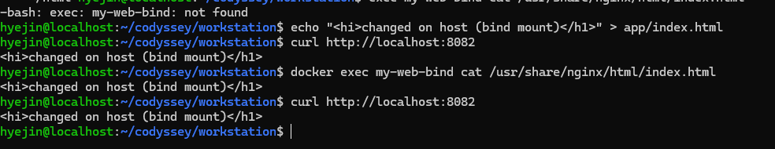
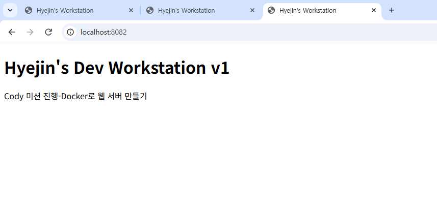
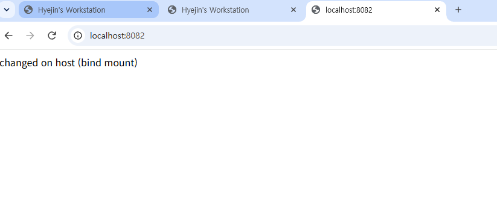

### 5-9. 볼륨 영속성

```bash
$ docker volume create mydata
mydata
$ docker volume ls
DRIVER    VOLUME NAME
local     mydata

$ docker run -d --name vol-test -v mydata:/data ubuntu sleep infinity
$ docker exec vol-test bash -c "echo 'hello volume' > /data/hello.txt"
$ docker exec vol-test cat /data/hello.txt
hello volume

$ docker rm -f vol-test                  # 컨테이너 삭제
vol-test
$ docker ps -a | grep vol-test           # 출력 없음 = 완전히 삭제됨

$ docker run -d --name vol-test2 -v mydata:/data ubuntu sleep infinity
$ docker exec vol-test2 cat /data/hello.txt
hello volume                             # 새 컨테이너에서도 데이터 유지
```

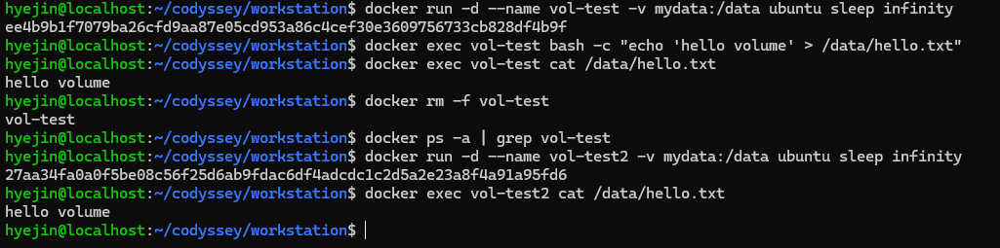

볼륨 문제가 생겼을 때 확인할 점:
- 이름 확인: `docker volume ls`로 의도한 볼륨이 맞는지 본다. 없는 이름을 `-v`에 쓰면 오류 없이 새 볼륨이 만들어진다 (트러블슈팅 문제 2).
- 위치·드라이버 확인: `docker volume inspect mydata`로 `Driver`(기본 `local`)와 `Mountpoint`를 본다. Docker Desktop에서는 이 경로가 Docker 전용 VM 안에 있어서 Windows 탐색기나 Ubuntu에서 직접 보이지 않는다.
- 권한 확인: 컨테이너 안에서 `ls -l /data`로 파일 소유자를 본다. 컨테이너를 root가 아닌 사용자로 실행하면 root가 만든 파일에 쓰기 권한이 없어 `Permission denied`가 날 수 있다.
- 사용 중 확인: 컨테이너가 연결된 볼륨은 `docker volume rm`이 거부된다. `docker ps -a --filter volume=mydata`로 어떤 컨테이너가 쓰는지 찾는다.

볼륨 백업/복원 절차 (권장):

```bash
# 백업: 임시 컨테이너로 볼륨 내용을 현재 폴더의 tar 파일로 묶기
docker run --rm -v mydata:/data -v "$(pwd)":/backup ubuntu tar czf /backup/mydata-backup.tgz -C /data .

# 복원: 새 볼륨을 만들고 tar 파일을 풀어 넣기
docker volume create mydata-restore
docker run --rm -v mydata-restore:/data -v "$(pwd)":/backup ubuntu tar xzf /backup/mydata-backup.tgz -C /data
docker run --rm -v mydata-restore:/data ubuntu cat /data/hello.txt
```

`--rm`을 붙인 임시 컨테이너가 볼륨과 현재 폴더를 동시에 연결해 파일을 옮기는 방식이다. 백업 파일에는 데이터가 그대로 들어 있으므로 Git 저장소에 올리지 않는다.

### 5-10. Git 설정 및 GitHub 연동

```bash
$ git config --list
user.name=haegirl23-max
user.email=300758409+haegirl23-max@users.noreply.github.com
init.defaultbranch=main
core.repositoryformatversion=0
core.filemode=true
core.bare=false
core.logallrefupdates=true

$ git init
Initialized empty Git repository in /home/hyejin/codyssey/workstation/.git/
$ git add .
$ git commit -m "initial commit: dev workstation mission"
[main (root-commit) f91957b] initial commit: dev workstation mission
 8 files changed, 236 insertions(+)
$ git log --oneline
f91957b (HEAD -> main) initial commit: dev workstation mission

$ git remote add origin https://github.com/haegirl23-max/codyssey_test.git
$ git push -u origin main --force
...
To https://github.com/haegirl23-max/codyssey_test.git
 + 06b11c2...f91957b main -> main (forced update)
branch 'main' set up to track 'origin/main'.
```

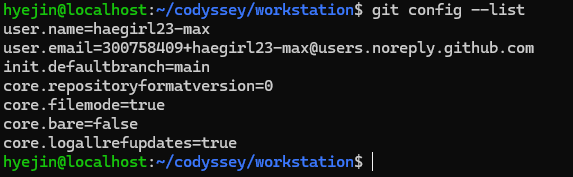
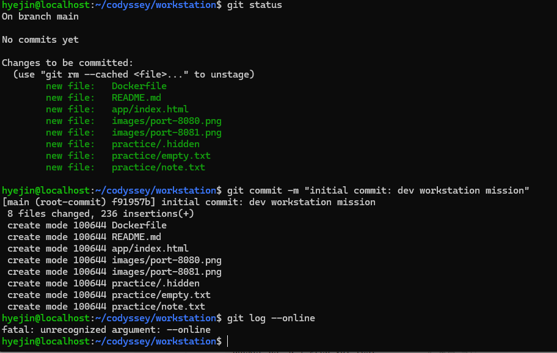
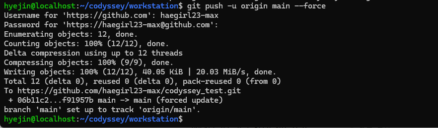

- 공개 저장소이므로 개인 이메일 대신 GitHub noreply 주소를 사용했다.
- 인증은 GitHub 비밀번호가 아닌 Personal Access Token으로 했고, 토큰은 문서와 캡처에 남기지 않았다.


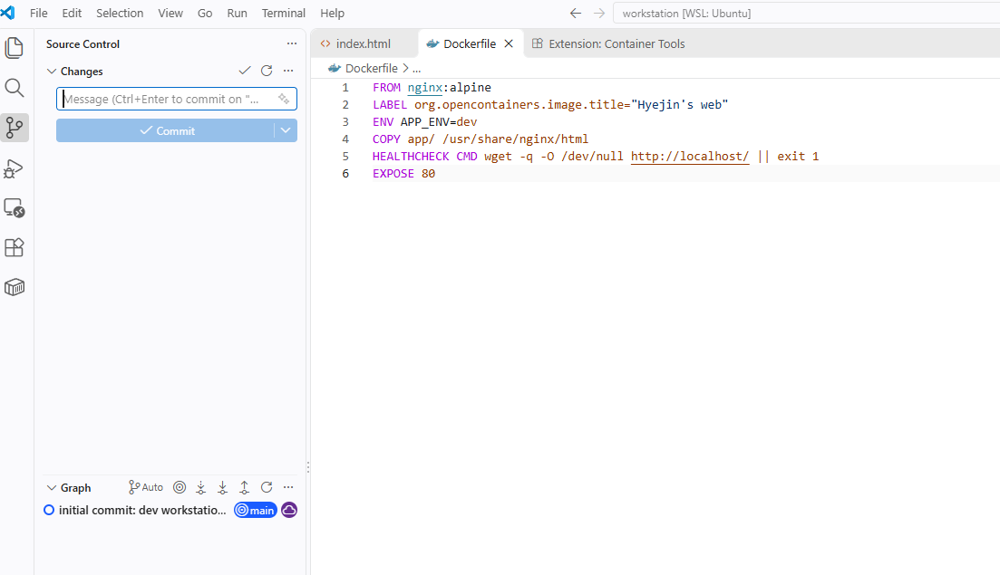

push 전 보안 체크리스트:
- [x] 저장소 공개 범위 확인: 제출용이라 Public. 개인 프로젝트나 회사 코드는 Private로 만든다.
- [x] `git config user.email`이 noreply 주소인지 확인
- [x] `git status`, `git diff --staged`로 올라갈 파일을 확인해 토큰·비밀번호·`.env` 같은 파일이 없는지 점검
- [x] 스크린샷에 토큰, 비밀번호, 개인 이메일이 찍히지 않았는지 확인 (개인 Gmail이 보이는 `git config` 캡처는 제외)
- [x] 토큰은 필요한 권한(repo)과 짧은 만료(30일)로 발급하고, 다 쓴 토큰은 삭제
- [x] `--force` push는 혼자 쓰는 저장소에서만 사용

## 6. 검증 방법 요약

| 항목 | 확인 명령 | 결과 | 증거 |
| --- | --- | --- | --- |
| Docker 데몬 | `docker info` | Server Version 29.9.2 출력 | [5-3](#5-3-docker-설치-점검) |
| 컨테이너 실행 | `docker run hello-world` | Hello from Docker! | [5-4](#5-4-컨테이너-실행-실습) |
| 커스텀 이미지 | `docker build` | my-web:1.0 생성, healthy | [5-6](#5-6-dockerfile-커스텀-이미지) |
| 포트 매핑 | `curl localhost:8080/8081` + 브라우저 | 내 페이지 응답 | [5-7](#5-7-포트-매핑-접속) |
| 포트 충돌 | `docker ps --filter "publish=8080"`, `docker port` | 점유 컨테이너 특정 후 해제·재실행 성공 | [5-7-1](#5-7-1-포트-충돌-진단과-해결) |
| 바인드 마운트 | 호스트 수정 후 `curl` | 재빌드 없이 반영 | [5-8](#5-8-바인드-마운트) |
| 볼륨 | 컨테이너 삭제 후 `cat` | 데이터 유지 | [5-9](#5-9-볼륨-영속성) |
| Git/GitHub | `git config --list`, `git push` | 설정 확인, push 성공 | [5-10](#5-10-git-설정-및-github-연동) |

## 7. 트러블슈팅

### 문제 1: Ubuntu에서 Docker 데몬에 연결되지 않음
- **문제**: `docker info` 실행 시 `The command 'docker' could not be found in this WSL 2 distro. We recommend to activate the WSL integration` 오류
- **원인 가설**: Docker Desktop과 WSL Ubuntu의 연동이 꺼져 있어서, Windows 쪽 docker 클라이언트만 응답하고 데몬에는 접근하지 못함
- **확인**: 플러그인 경로가 `C:\Program Files\Docker\...`로 표시됨. Docker Desktop › Settings › Resources › WSL Integration에서 Ubuntu가 꺼져 있었음
- **해결**: Ubuntu 연동을 켜고 Apply & restart. 이후 경로가 `/usr/local/lib/docker/...`로 바뀌고 `docker info`에 Server 정보가 정상 출력됨

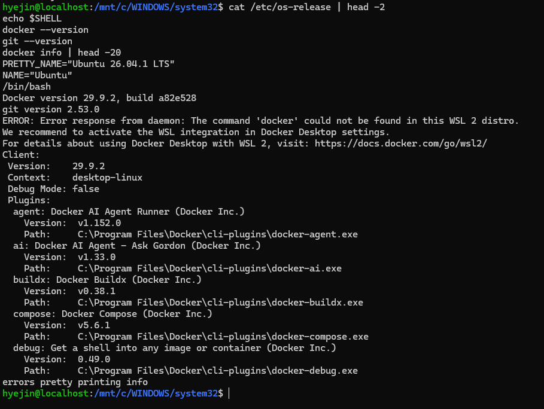


### 문제 2: 컨테이너를 삭제한 뒤 볼륨 데이터가 사라진 것처럼 보임
- **문제**: 새 컨테이너 `vol-test2`에서 `cat /data/hello.txt` 실행 시 `No such file or directory`
- **원인 가설**: 첫 컨테이너를 만들 때 볼륨 이름을 잘못 입력해 다른 볼륨에 저장됨
- **확인**: 첫 실행 명령이 `-v madata:/data`(mydata 오타)였음. Docker는 없는 볼륨 이름을 받으면 오류 없이 새 볼륨을 자동 생성함. `docker volume ls`에서 `madata` 볼륨을 발견했고, `madata`를 새 컨테이너에 연결하자 `hello volume`이 그대로 있었음
- **해결**: 잘못 생성된 컨테이너와 `madata` 볼륨을 삭제하고 `mydata`로 다시 실행해 영속성 확인. Tab 자동완성으로 이름 오타를 방지

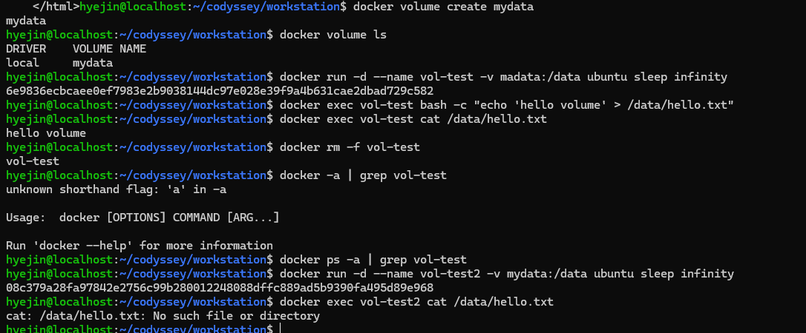

### 문제 3: git push가 거부됨
- **문제**: `git push` 시 `! [rejected] main -> main (fetch first)`
- **원인 가설**: GitHub에서 저장소를 만들 때 자동 생성된 커밋이 원격에만 있어서, Git이 덮어쓰기를 막음
- **확인**: GitHub 저장소 페이지에서 내가 올리지 않은 자동 생성 파일을 확인
- **해결**: 원격 내용이 버려도 되는 자동 생성 파일뿐이라 `git push -u origin main --force`로 내 커밋을 올림. 협업 저장소라면 `git pull`로 먼저 합쳐야 함

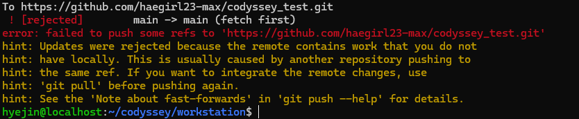

### 그 밖에 겪은 문제
- `cat .etc/os-release` → `No such file`: `/etc`(절대 경로)를 `.etc`(상대 경로의 숨김 폴더)로 잘못 입력
- `docker run --name my -ubuntu ...` → `unable to find user buntu`: 띄어쓰기 때문에 `-ubuntu`가 `-u buntu`(사용자 지정 옵션)로 해석됨
- PowerShell에서 `head` 실행 오류, `wsl ~`가 `docker-desktop` 배포판으로 진입: `wsl --set-default Ubuntu`로 기본 배포판 변경
- 닫는 따옴표 누락으로 프롬프트가 `>`로 바뀌어 대기: `Ctrl+C`로 취소 후 재입력

## 8. 개념 정리

- **절대 경로 vs 상대 경로**: `/home/hyejin/codyssey`처럼 `/`(루트)부터 시작하면 어디서 실행해도 같은 위치를 가리키는 절대 경로다. `practice`, `../`처럼 현재 위치를 기준으로 하면 상대 경로라서 실행 위치에 따라 결과가 달라진다. 컨테이너 안 `/`에서 `.etc/os-release`를 입력했을 때 실패한 것은 상대 경로로 해석됐기 때문이다.
    - 바인드 마운트의 호스트 경로는 `-v "$(pwd)/app":...`처럼 절대 경로로 쓴다. `-v app:/...`처럼 `/` 없이 쓰면 폴더가 아니라 `app`이라는 이름의 볼륨으로 해석된다. Windows에서는 `/mnt/c`, `/mnt/d`보다 WSL 홈(`~`) 아래 경로를 마운트해야 권한이 제대로 적용되고 파일 반영도 빠르다. 컨테이너가 고치면 안 되는 폴더는 `:ro`(읽기 전용)를 붙인다.
- **권한 r/w/x와 755·644**: 권한은 소유자/그룹/기타 세 자리이고, 각 자리는 r=4, w=2, x=1을 더한 값이다. 755는 소유자 rwx(7), 그룹과 기타 r-x(5)로 디렉토리나 실행 파일에 쓴다. 644는 소유자 rw-(6), 나머지 r--(4)로 일반 파일에 쓴다. 디렉토리에서 x는 들어갈 수 있는 권한(cd), r은 목록을 볼 수 있는 권한(ls)이다.

    | 권한 | 표기 | 주로 쓰는 대상 |
    | --- | --- | --- |
    | 644 | `-rw-r--r--` | 일반 파일, 웹 루트의 HTML·CSS (nginx가 읽기만 하면 됨) |
    | 755 | `rwxr-xr-x` | 디렉토리, 실행 스크립트(`.sh`), 웹 루트 폴더 |
    | 600 | `-rw-------` | SSH 개인키(`~/.ssh/id_ed25519`), 토큰이 든 설정 파일 |
    | 700 | `rwx------` | `~/.ssh` 폴더처럼 나만 쓰는 디렉토리 |
    | 777 | `rwxrwxrwx` | 모두에게 쓰기 허용. 보안상 피해야 함 |
- **커스텀 이미지**: 기존 이미지(nginx:alpine)를 `FROM`으로 가져와 그 위에 내 파일과 설정을 층(레이어)으로 쌓은 이미지다. 한 번 빌드하면 어디서 실행해도 같은 환경이 재현된다.
- **이미지 vs 컨테이너**: 이미지는 빌드가 끝나면 바뀌지 않는(불변, immutable) 설계도이고, 컨테이너는 그 이미지 위에 쓰기 가능한 층을 하나 얹어 실행한(가변, runtime) 인스턴스다. 컨테이너 안에서 파일을 바꿔도 이미지는 그대로이고, 컨테이너를 지우면 그 변경도 사라진다. 그래서 남겨야 할 데이터는 볼륨에 둔다.
- **포트 매핑이 필요한 이유**: 컨테이너는 격리된 자체 네트워크를 쓰기 때문에 컨테이너 안의 80번 포트는 호스트에서 바로 접근할 수 없다. `-p 8080:80`은 호스트 8080으로 온 요청을 컨테이너 80으로 전달한다. 호스트 포트만 다르게 하면 같은 이미지를 여러 개 동시에 띄울 수 있다.
- **Docker 네트워크 모드**: 이번 실습은 기본값인 bridge를 썼다.

    | 모드 | 동작 | 포트 접근 |
    | --- | --- | --- |
    | bridge (기본) | 컨테이너마다 가상 네트워크와 IP(예: 172.17.0.x)를 받음 | `-p`로 매핑해야 호스트에서 접근 가능 |
    | host | 컨테이너가 호스트 네트워크를 그대로 같이 씀 | 매핑 없이 호스트 포트를 바로 사용, 대신 격리가 약하고 포트가 겹치면 충돌 |
    | none | 네트워크 없음 | 외부 통신 불가 |

    5-7의 nginx 로그에 찍힌 `172.17.0.1`이 bridge 네트워크에서 호스트가 쓰는 주소다. Docker Desktop(Windows)에서는 host 모드가 Windows가 아니라 Docker VM의 네트워크를 가리키므로, Windows에서 접속하려면 bridge + `-p`가 일반적이다.
- **Docker 볼륨**: 컨테이너 내부 파일은 컨테이너를 지우면 함께 사라진다. 볼륨은 Docker가 컨테이너 밖에서 관리하는 저장 공간이라 컨테이너를 삭제해도 데이터가 남는다. DB 데이터처럼 보존해야 하는 것을 넣는다. 바인드 마운트는 내가 지정한 호스트 폴더를 그대로 연결하는 방식으로, 개발 중 코드 수정을 바로 반영할 때 쓴다.
- **Git vs GitHub**: Git은 내 PC에서 파일의 변경 이력을 관리하는 로컬 버전 관리 도구다. GitHub는 Git 저장소를 온라인에 올려 공유·리뷰·협업하는 원격 플랫폼이다. Git은 인터넷 없이도 쓸 수 있고, GitHub와는 push/pull로 연결한다.

## 9. 재현 시 주의사항

- Windows에서는 WSL2 Ubuntu 터미널에서 실습한다. 프롬프트가 `PS C:\...>`이면 PowerShell이므로 `wsl ~`로 Ubuntu에 들어간다.
- `wsl ~`가 `docker-desktop`으로 들어가면 `wsl --set-default Ubuntu`로 기본 배포판을 바꾼다.
- 실습 폴더는 WSL 홈(`~`) 아래에 둔다. `/mnt/c`, `/mnt/d` 같은 Windows 드라이브는 리눅스 권한을 지원하지 않아, 거기서 가져온 파일은 `-rwxr-xr-x`로 표시되고 chmod가 제대로 반영되지 않는다. (D드라이브에서 복사한 README.md도 755로 들어와 `chmod 644`로 바꿨다.)
- Docker Desktop의 WSL Integration에서 Ubuntu를 켜야 Ubuntu 터미널에서 docker를 쓸 수 있다.
- Git은 빈 디렉토리를 기록하지 않으므로 `practice/secret_dir`는 저장소에 포함되지 않는다.

Windows(WSL2) 환경과 일반 Linux 환경의 차이:

| 항목 | Windows + WSL2 + Docker Desktop (이번 실습) | 일반 Linux (예: Ubuntu 서버) |
| --- | --- | --- |
| Docker 설치 | Docker Desktop 설치 후 WSL Integration에서 Ubuntu 켜기 | `apt`로 Docker Engine 설치, `sudo usermod -aG docker $USER` |
| 데몬 확인 | Docker Desktop 실행 여부 + `docker info` | `systemctl status docker` + `docker info` |
| `localhost:8080` 접속 | Windows 브라우저에서 바로 됨 (Docker Desktop이 포워딩) | 같은 서버에서 바로 됨 |
| 포트 점유 확인 | Windows: `netstat -ano \| findstr :8080` | `ss -ltnp \| grep 8080` |
| 볼륨 실제 위치 | Docker VM 안이라 직접 접근 불가 | `/var/lib/docker/volumes/` (root 권한 필요) |
| 파일 권한 | WSL 홈은 정상, `/mnt/c`·`/mnt/d`는 chmod 미반영 | 정상 |
| 터미널 혼동 | PowerShell(`PS C:\>`)과 Ubuntu(`$`)를 구분해야 함 | 해당 없음 |

## 10. 보안 및 개인정보 보호

- 커밋 이메일은 GitHub noreply 주소를 사용했다.
- GitHub 인증은 Personal Access Token(만료 30일, repo 권한만)으로 했고, 토큰과 비밀번호는 문서와 캡처에 포함하지 않았다.
- 사용이 끝난 토큰은 GitHub › Settings › Developer settings › Personal access tokens에서 삭제했다. 토큰이 노출되면 즉시 삭제하고 재발급한다.
