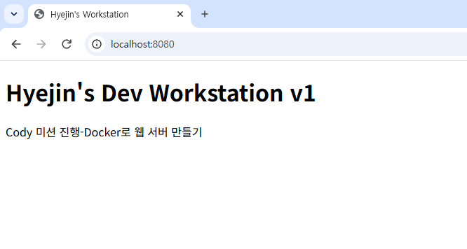
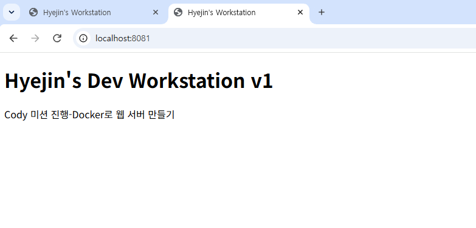
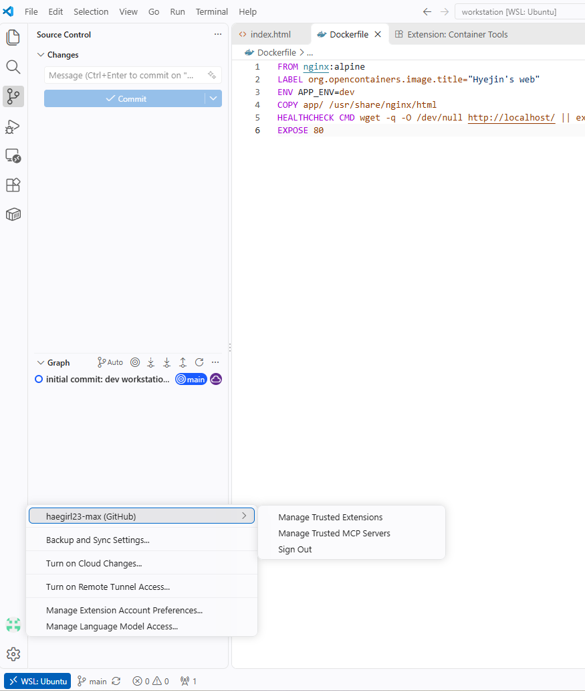

# 내 컴퓨터에 개발용 '작업실' 꾸미기

> 코디세이 AI 올인원 1기 입학 연수 미션 — 개발 워크스테이션 구축 기록
> (이 파일은 틀입니다. `<!-- -->` 안내문과 `TODO` 자리를 실제 명령·출력으로 채우고, 파일명을 README.md로 바꿔 저장소 최상단에 두세요.)

## 1. 프로젝트 개요

- 목표: 터미널·Docker·Git을 직접 세팅하고, 누가 실행해도 같은 결과가 나오는 개발 환경을 구성한다.
- 수행 범위: 터미널 조작 → 권한 → Docker 점검/운영 → Dockerfile 커스텀 이미지 → 포트 매핑 → 바인드 마운트/볼륨 → Git/GitHub 연동

## 2. 실행 환경

| 항목 | 값 |
| --- | --- |
| Host OS | Windows TODO (예: Windows 11 Pro 23H2) |
| Linux 환경 | WSL2 Ubuntu TODO |
| Shell / 터미널 | bash / Windows Terminal |
| Docker | TODO (`docker --version` 결과) |
| Git | TODO (`git --version` 결과) |

```bash
$ cat /etc/os-release | head -2
TODO
$ echo $SHELL
TODO
$ docker --version
TODO
$ git --version
TODO
```

## 3. 수행 체크리스트

- [ ] 터미널 기본 조작 및 폴더 구성
- [ ] 권한 변경 실습 (파일 1, 디렉토리 1)
- [ ] Docker 설치/점검 (version, info)
- [ ] hello-world 실행 / ubuntu 컨테이너 진입
- [ ] Docker 운영 명령 (images, ps -a, logs, stats)
- [ ] Dockerfile 커스텀 이미지 빌드/실행
- [ ] 포트 매핑 접속 (2회)
- [ ] 바인드 마운트 반영
- [ ] 볼륨 영속성
- [ ] Git 설정 + VSCode GitHub 연동

## 4. 저장소 구조

```
.
├── README.md
├── Dockerfile
├── app/
│   └── index.html
└── images/        # 스크린샷
```

## 5. 수행 로그

### 5-1. 터미널 기본 조작

```bash
$ pwd
TODO
$ mkdir -p ~/codyssey/workstation
$ cd ~/codyssey/workstation
$ ls -la
TODO
# (생성 / 빈 파일 / 내용 확인 / 숨김 파일 / 복사 / 이름변경 / 이동 / 삭제 출력 붙이기)
```

### 5-2. 권한 실습

```bash
$ ls -l note.txt
TODO   # 변경 전
$ chmod 755 note.txt
$ ls -l note.txt
TODO   # 변경 후

$ ls -ld secret_dir
TODO   # 변경 전
$ chmod 700 secret_dir
$ ls -ld secret_dir
TODO   # 변경 후
```

### 5-3. Docker 설치 점검

```bash
$ docker --version
TODO
$ docker info
TODO   # Server 부분 발췌
```

### 5-4. 컨테이너 실행 실습

```bash
$ docker run hello-world
TODO
$ docker run -it --name my-ubuntu ubuntu bash
root@...:/# ls
TODO
root@...:/# echo "inside container"
TODO
```

**attach vs exec 관찰 결과**: TODO (직접 관찰한 내용 2~3줄)

### 5-5. Docker 운영 명령

```bash
$ docker images
TODO
$ docker ps -a
TODO
$ docker logs <컨테이너>
TODO
$ docker stats --no-stream
TODO
```

### 5-6. Dockerfile 커스텀 이미지

- 선택한 방식: TODO (예: (A) nginx:alpine 베이스 + 정적 콘텐츠 교체)
- 베이스 선택 이유: TODO

| 커스텀 포인트 | 목적 |
| --- | --- |
| TODO (예: COPY app/) | TODO |
| TODO (예: ENV) | TODO |
| TODO (예: HEALTHCHECK) | TODO |

```bash
$ docker build -t my-web:1.0 .
TODO
```

### 5-7. 포트 매핑 접속

```bash
$ docker run -d -p 8080:80 --name my-web-8080 my-web:1.0
$ curl http://localhost:8080
TODO
$ docker run -d -p 8081:80 --name my-web-8081 my-web:1.0
$ curl http://localhost:8081
TODO
```




### 5-8. 바인드 마운트

```bash
$ docker run -d -p 8082:80 --name my-web-bind -v "$(pwd)/app":/usr/share/nginx/html my-web:1.0
$ curl http://localhost:8082
TODO   # 변경 전
$ echo "<h1>Changed on host</h1>" > app/index.html
$ curl http://localhost:8082
TODO   # 변경 후
```

### 5-9. 볼륨 영속성

```bash
$ docker volume create mydata
$ docker run -d --name vol-test -v mydata:/data ubuntu sleep infinity
$ docker exec vol-test bash -lc "echo hi > /data/hello.txt && cat /data/hello.txt"
TODO
$ docker rm -f vol-test
$ docker run -d --name vol-test2 -v mydata:/data ubuntu sleep infinity
$ docker exec vol-test2 cat /data/hello.txt
TODO   # 삭제 후에도 유지됨
```

### 5-10. Git 설정 및 GitHub 연동

```bash
$ git config --list
TODO   # 이메일 등 민감정보는 마스킹
```



## 6. 검증 방법 요약

| 항목 | 확인 명령 | 기대 결과 | 증거 위치 |
| --- | --- | --- | --- |
| Docker 데몬 | `docker info` | Server 정보 출력 | [5-3](#5-3-docker-설치-점검) |
| 포트 매핑 | `curl localhost:8080` | 내 페이지 HTML | [5-7](#5-7-포트-매핑-접속) |
| 바인드 마운트 | 호스트 수정 후 `curl` | 재빌드 없이 변경 반영 | [5-8](#5-8-바인드-마운트) |
| 볼륨 | 컨테이너 삭제 후 `cat` | 데이터 유지 | [5-9](#5-9-볼륨-영속성) |
| Git | `git config --list` | user.name, init.defaultBranch | [5-10](#5-10-git-설정-및-github-연동) |

## 7. 트러블슈팅

### 문제 1: TODO
- 문제: TODO
- 원인 가설: TODO
- 확인: TODO
- 해결/대안: TODO

### 문제 2: TODO
- 문제: TODO
- 원인 가설: TODO
- 확인: TODO
- 해결/대안: TODO

## 8. 개념 정리

- 절대 경로 vs 상대 경로: TODO
- 권한 r/w/x와 755·644: TODO
- 커스텀 이미지: TODO
- 포트 매핑이 필요한 이유: TODO
- Docker 볼륨: TODO
- Git vs GitHub: TODO

## 9. 재현 시 주의사항

- Windows 사용 시 실습 폴더는 WSL 홈(`~`) 아래에 둔다. `/mnt/c`, `/mnt/d`에서는 chmod가 반영되지 않는다.
- 토큰·비밀번호·개인 이메일은 로그와 스크린샷에서 마스킹했다.
